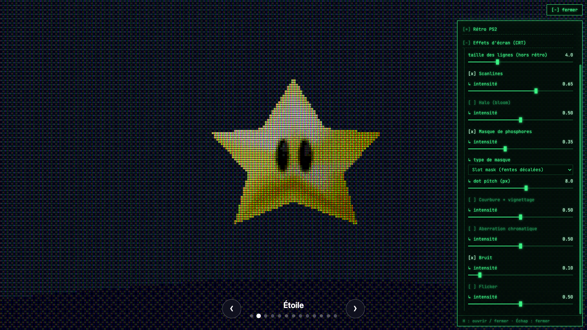

# Retro Shaders



Un projet expérimental autour de Three.js, GLSL et des graphismes rétro.

**Retro Shaders** est un projet qui explore l'esthétique des jeux vidéo de l'ère PlayStation 2 / GameCube et le rendu caractéristique des anciens écrans CRT.

L'idée est de proposer un visualiseur 3D interactif dans lequel il est possible d'afficher des modèles, de les manipuler et d'expérimenter différents effets graphiques inspirés de cette époque.

Le projet combine des techniques de post-traitement, des shaders personnalisés et une interface de réglages permettant de modifier les effets en temps réel.

## Fonctionnalités

- Scène 3D intéractive
- Plateau rotatif pour observer les modèles sous différents angles
- Ajustement individuel de l'échelle des modèles
- Effets graphiques personnalisables en temps réel
- Interface de réglages développée sur mesure

## Effets visuels

Les effets sont réalisés à l'aide de shaders GLSL et permettent de combiner plusieurs caractéristiques graphiques des jeux rétro et des écrans cathodiques.

### Rendu rétro PS2

**Vertex Snapping**

Simule la précision limitée des calculs de position des sommets que l'on pouvait retrouver dans les anciens moteurs 3D. Les sommets sont quantifiés sur une grille de coordonnées, ce qui produit de légères variations dans leur position lorsque la caméra ou les objets se déplacent.

Cela donne une impression de géométrie instable, de mouvements saccadés et de contours qui semblent légèrement trembler, caractéristiques de certains rendus 3D rétro.

**Quantification des couleurs**

Réduit le nombre de niveaux de couleur disponibles dans l'image. Chaque canal RGB dispose ainsi d'un nombre plus limité de valeurs possibles.

Le résultat donne une palette plus restreinte et des transitions de couleurs moins progressives, rappelant certaines contraintes graphiques des anciennes générations de consoles, avec les couleurs gérées en 4 bits, ou 8 bits par exemple.

**Dithering ordonné**

Utilise une matrice de Bayer 4×4 pour répartir de légères variations de couleur entre les pixels. Cette technique permet de simuler davantage de nuances malgré une palette limitée et de créer des motifs caractéristiques des rendus rétro.

### Effets CRT

**Courbure (Curvature)**

Reproduit la forme bombée des anciens écrans cathodiques en déformant les coordonnées de l'image. Plus on s'approche des bords, plus la déformation devient importante.

Les côtés et les coins semblent ainsi se replier vers l'intérieur, donnant l'impression que l'image est affichée sur la surface incurvée d'un tube cathodique. Les zones situées en dehors de l'image déformée sont remplacées par du noir.

**Aberration chromatique (Chromatic Aberration)**

Simule les petites imperfections d'alignement des couleurs que l'on peut observer sur certains vieux écrans.

Les canaux rouge et bleu sont légèrement décalés dans des directions opposées, tandis que le canal vert reste à sa position initiale. Le décalage augmente progressivement en s'éloignant du centre de l'écran.

Cela crée de fines ombres/zones colorées autour des objets et des contours.

**Halo lumineux (Halo)**

Reproduit la diffusion de lumière autour des zones particulièrement lumineuses d'un écran cathodique.

Le shader effectue plusieurs prélèvements autour de chaque pixel, puis privilégie les zones dont la luminosité dépasse un certain seuil. Les couleurs ainsi récupérées sont combinées avec une pondération qui favorise les prélèvements les plus proches.

Le résultat est une légère diffusion lumineuse autour des éléments clairs, qui donne davantage de présence aux sources lumineuses et aux couleurs intenses.

**Masque de phosphores (Phosphor Mask)**

Simule la disposition physique des minuscules éléments phosphorescents rouges, verts et bleus qui composent l'image d'un écran CRT.

Contrairement à un simple filtre coloré, le masque reproduit un motif répétitif à l'échelle des pixels physiques de l'écran. Il modifie séparément les composantes rouge, verte et bleue de l'image.

Trois motifs sont disponibles :

- **Aperture Grille** : reproduit les bandes verticales continues de phosphores rouges, verts et bleus, caractéristiques des écrans à grille d'ouverture, notamment les Trinitron (de chez Sony).

- **Shadow Mask** : reproduit de petits points de phosphores RGB disposés en triades. Les rangées sont décalées les unes par rapport aux autres pour former une disposition en quinconce.

- **Slot Mask** : combine des bandes verticales RGB avec des interruptions horizontales, donnant un motif composé de segments lumineux.

Chaque motif possède une structure et une répartition des couleurs différentes, ce qui permet d'obtenir plusieurs rendus CRT.

**Scanlines**

Reproduit les lignes horizontales caractéristiques des écrans cathodiques.

L'effet alterne des rangées plus lumineuses et plus sombres en fonction de la position verticale dans l'image. La fréquence des lignes est liée à la résolution CRT utilisée par le shader.

Cela permet de retrouver l'aspect strié des anciens écrans, tout en conservant une intensité réglable pour éviter que les lignes ne deviennent trop visibles.

**Bruit (Noise)**

Ajoute un grain animé à l'image afin de reproduire les petites variations visuelles associées aux signaux analogiques.

Le bruit est généré à partir d'une fonction pseudo-aléatoire et calculé à l'échelle des gros pixels (taille choisie depuis l'interface, plutôt que la taille physique des pixels de l'acran) de l'image. Son motif évolue à 24 images par seconde, ce qui lui donne une animation légèrement irrégulière plutôt qu'un bruit parfaitement fluide.

**Scintillement (Flicker)**

Simule les légères variations de luminosité des anciens écrans cathodiques. Une bande sombre se déplace également lentement sur l'image.

**Vignettage (Vignette)**

Assombrit progressivement les bords et les coins de l'image. L'effet est lié à la courbure de l'écran pour renforcer l'impression de regarder un véritable écran CRT.

## 🛠️ Installation & Lancement

1. **Cloner le dépôt :**

   ```bash
   git clone https://github.com/Rekuiem84/retro-shaders
   cd retro-shaders
   ```

2. **Installer les dépendances :**

   ```bash
   npm install
   ```

3. **Lancer le serveur de développement :**

   ```bash
   npm run dev
   ```

4. **Build pour la production :**

   ```bash
   npm run build
   ```

Les fichiers optimisés seront générés dans le dossier `dist/`.

## 📁 Structure du projet

```
retro-shaders/
├── src/
│    ├── index.html
│    ├── script.js
│    ├── style.css
│    ├── terminal.css
│    ├── terminal.js
│    └── retro/
│          ├── fragment.glsl
│          ├── snap.glsl
│          └── vertex.glsl
└── static/
    ├── draco/
    └── models/
```
